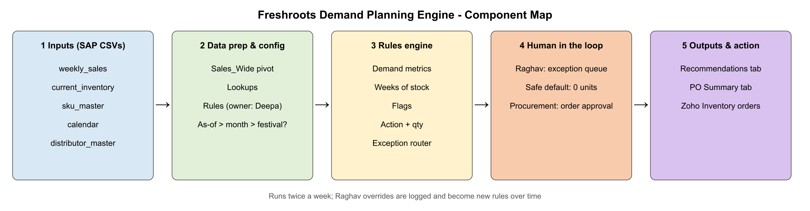

# Freshroots — Deepa's 90-Day Mandate
### MESA AI-Native Track · Term 2 · Case 01 (22 Oct)

**Task:** Use the 9 checks to decide which of Deepa's three initiatives to solve first, then build that solution end to end.
**Data used:** only the seed files provided: `weekly_sales.csv`, `current_inventory.csv`, `sku_master.csv`, `calendar.csv`, `distributor_master.csv`.

**Answer: solve Demand Planning first.** It's the only initiative where the problem is costed, the data exists, and the logic is already written down. A rules engine can handle about 80% of products, and Raghav's judgment is kept for the exceptions.

---

## 1. Case summary

Deepa Nair is Head of Operations at Freshroots, a regional FMCG company with 200 people, covering Maharashtra and Goa. The CEO wants AI running by Q1, with a budget of **₹15 lakhs** and **90 days**. There is no AI team: only 3 IT staff who look after SAP, and one data analyst.

| Initiative | Current state | Problem |
|---|---|---|
| **Demand Planning** | Raghav does a monthly forecast by hand. It takes 2 days and covers 400 SKUs and 1,200 distributors. | Data is 3–4 weeks old by the time it's used. Stockouts cost ₹18–22L a quarter and perishable write-offs ₹10–12L a quarter, so **₹28–34L every quarter**. |
| **Distributor Service** | 4 people answer 50–80 WhatsApp messages a day. There's no ticketing and no tracking. | 3 distributors were lost. A ₹28L account in Nashik cut orders by 30% after missing a scheme. |
| **Operations Intelligence** | Priya builds a 12-metric report every Monday. It takes 4 hours. | A ₹22L purchase was made on stale data, leading to a **₹9L write-off**. The real issue is the weekly cycle and the fact that nobody owns acting on a change. |

---

## 2. The Nine Checks: does this deserve to be built?

| Group | Rule |
|---|---|
| **Kill switches** (01, 02, 03) | Any No means **don't build it** |
| **Sizing** (04, 05, 08) | Any No means **build something smaller** |
| **Boundary** (06, 07, 09) | Any No means **put a human exactly here** |

### 2.1 Full evaluation

| Group | # | Check | Demand Planning | Distributor Service | Operations Intelligence |
|---|---|---|---|---|---|
| Kill switch | 01 | Problem real? | **Yes.** ₹28–34L lost every quarter to stockouts and write-offs. Forecasts are 3–4 weeks stale. | **Yes.** 3 distributors lost; Nashik account cut orders 30%. But the root cause was a missed notification (a process failure), not message volume. | **Yes.** ₹9L write-off. But it's a single incident in 3 months. |
| Kill switch | 02 | Workflow repeated? | **Yes.** Monthly, 2 days, 400 SKUs. Raghav wants to run it twice a week. | **Yes.** 50–80 messages every day. | **Yes.** Every Monday, 4 hours, the same 12 metrics for 2 years. |
| Kill switch | 03 | Input available? | **Yes.** 3 years of structured, exportable SAP data. The seed data confirms sales, inventory, SKU, calendar and distributor files. | **No.** No WhatsApp archive, no query categories, no response times. The "60–70% repetitive" figure is unproven. → **Stop: fix data capture first.** | **Yes.** 2 years of clean SAP data; the metrics are well defined. |
| Sizing | 04 | Output valuable? | **Yes.** A per-SKU decision (reorder / 1.5× / pause) that procurement acts on directly. | **Partial.** Auto-answering helps, but the actual loss (a missed scheme) needs a broadcast process, not a bot. | **Partial.** A faster dashboard alone changes nothing; the bottleneck is who acts. |
| Sizing | 05 | Impact measurable? | **Yes.** Baselines exist: stockout ₹, write-off ₹, cycle time, % handled automatically. | **No.** No starting numbers for response time, resolution rate or query mix. | **Partial.** Time from alert to action can be measured from now on, but there's no history to compare against. |
| Sizing | 08 | ROI worth it? | **Yes.** 80–85% of the logic is already written down. A 20% cut in errors ≈ ₹5.6–6.8L a quarter (₹22–27L a year) vs the ₹15L budget. Low build cost. | **Unknown.** High upside (a distributor is worth ₹18–25L a year and costs ₹1.5–2L to replace), but it can't be sized without data. | **Partial.** Saves 4 hours a week; avoided losses are occasional and uncertain. |
| Boundary | 06 | Failure risk OK? | **Partial.** A wrong reorder means a stockout or a write-off, worst for perishables. → **Human approval before any order is placed.** | **No.** A wrong answer on credit or a scheme goes straight to a distributor and damages the relationship. → A human must review replies. | **Yes.** Alerts are informational only. |
| Boundary | 07 | Judgment protected? | **Partial.** 15–20% of cases (new launches, unusual distributor behaviour, one-off events) need Raghav's judgment. → **Exceptions go to Raghav.** | **Partial.** Relationships and escalations stay with the CS rep. | **Yes.** The CEO and procurement still decide. |
| Boundary | 09 | Owner clear? | **Yes.** Raghav owns recommendations; procurement owns orders; Deepa owns the rules. | **Partial.** There's a CS lead, but no handover process when someone is on leave. | **No.** Nobody owns acting when a metric moves. → **Name an owner before building.** |
| | | **Count of Yes** | **7 / 9** | **2 / 9** | **5 / 9** |
| | | **Kill-switch No?** | No | **Yes (check 03)** | No |
| | | **Verdict** | ✅ **BUILD FIRST** | ❌ **DON'T BUILD (YET)** | ⚠️ **BUILD SMALLER, LATER** |

### 2.2 Verdicts explained

- **Demand Planning: build first.** It passes every kill switch and sizing check. The "Partial" answers in the boundary group tell us where people must stay involved: Raghav approves exceptions and procurement approves orders.
- **Distributor Service: don't build yet.** It fails check 03 (no input data). For the next 6 weeks, the team should log every WhatsApp query in a shared sheet with its category, time received and time answered. They should also set up a checklist for broadcasting schemes. Then run the 9 checks again with real data.
- **Operations Intelligence: build smaller, later.** The data is ready, but the real problem is ownership and the weekly rhythm. First name an owner and set a daily review. After that, a small daily SAP threshold alert is enough; an AI dashboard isn't needed.

---

## 3. The solution: Demand Planning Engine

### 3.1 Raghav's rules (from the case brief)

| # | Rule | Engine action |
|---|---|---|
| 1 | Average of the last 4 weeks is **more than 20% above** the 12-week average | Flag **High demand**; reorder at **1.5×** the standard quantity |
| 2 | Stock is **below 6 weeks** of average weekly sales | Flag **Stockout risk**; **reorder immediately** |
| 3 | Stock is **above 14 weeks** of average weekly sales | Flag **Overstock risk**; **pause the next order** |
| 4 | **Festival months** (Oct, Nov, Mar) | Apply a **+25% demand boost** before any threshold check |
| 5 | **Highly perishable** SKUs | Tighter limits: **minimum 3 weeks, maximum 4 weeks** |

### 3.2 Rule parameters (Rules tab, all editable)

| Parameter | Value | Source |
|---|---|---|
| As-of date | 19-Oct-2026 | `current_inventory.csv` |
| Planning month | 2026-10 | Worked out from the as-of date |
| Festival month? | TRUE | Looked up in `calendar.csv` |
| Festival boost | 25% | Case brief |
| Demand multiplier used | 1.25× | 1 + boost if it's a festival month |
| High-demand trigger | 20% | Case brief |
| High-demand reorder multiplier | 1.5× | Case brief |
| Minimum / maximum weeks of stock (low perishability) | 6 / 14 weeks | Case brief |
| Minimum / maximum weeks of stock (high perishability) | 3 / 4 weeks | Case brief |
| Recent / long averaging windows | 4 / 12 weeks | Case brief |

### 3.3 How I read the rules (documented assumptions)

1. **"Average weekly sales"** in the stock checks means the 12-week average × the festival multiplier. The boost is applied before the thresholds, as the brief says.
2. **The high-demand check** compares the real 4-week average against the real 12-week average. Boosting both sides would cancel out, so the boost isn't applied to this comparison.
3. **High demand during a festival month** could count the same spike twice (1.5× reorder plus the 25% boost), so these products go to Raghav.
4. **Supplier lead times aren't in the seed data**, so weeks of stock are measured against current stock only.
5. **Sales are by product, not by distributor.** The `Distributor_ID` in `sku_master` is used to group purchase orders.

### 3.4 Calculation steps (per SKU)

```
Last4Avg      = AVERAGE(last 4 weeks of sales)
Avg12         = AVERAGE(last 12 weeks of sales)
Trend         = Last4Avg / Avg12 − 1
AdjDemand     = Avg12 × (1.25 if festival month else 1)
WeeksCover    = UnitsOnHand / AdjDemand        (weeks of stock left)
MinCover      = 3 if Perishability = High else 6
MaxCover      = 4 if Perishability = High else 14

HighDemand    = Trend > 20%
StockoutRisk  = WeeksCover < MinCover
OverstockRisk = WeeksCover > MaxCover

RecommendedQty =
    0                    if OverstockRisk
    StdQty × 1.5         if HighDemand
    StdQty               if StockoutRisk
    0                    otherwise

CoverAfter    = (UnitsOnHand + RecommendedQty) / AdjDemand
```

### 3.5 When a product goes to Raghav

A product is sent to Raghav (marked **YES**) if any of these is true:

| Trigger | Why it matters |
|---|---|
| High demand **and** overstock | The two rules disagree |
| High demand **in a festival month** | The 1.5× and the 25% boost may double-count the same spike |
| Reordering, but cover after the order is **still below the minimum** | The standard quantity isn't enough |
| Reordering, but cover after the order is **above the maximum** | Too much stock for a perishable item |

**Safe default:** a flagged product releases **0 units** until Raghav chooses Approve, Modify or Reject (an override quantity is optional). Nothing reaches procurement unless a person has reviewed it.

**Final quantity sent to procurement:**
```
IF Override Qty entered → Override Qty
ELSE IF Decision = Reject → 0
ELSE IF flagged AND no decision yet → 0
ELSE → RecommendedQty
```

---

## 4. Results: run as of 19-Oct-2026 (festival month, +25% applied)

### 4.1 Per-SKU recommendations

| SKU | Product | Perish. | On hand | Std qty | 4-wk avg | 12-wk avg | Trend | Adj. demand | Weeks of stock | Status | Action | Rec. qty | Weeks after order | Raghav? |
|---|---|---|---|---|---|---|---|---|---|---|---|---|---|---|
| SKU001 | Mango Drink 200ml | Low | 900 | 500 | 261.0 | 214.9 | +21.4% | 268.6 | 3.35 | High demand + Stockout risk | Reorder immediately | **750** | 6.14 | **YES** |
| SKU002 | Oats Cookies 150g | Low | 1,200 | 200 | 83.8 | 83.8 | 0.0% | 104.7 | 11.46 | Healthy | No action | 0 | 11.46 | No |
| SKU003 | Brown Rice 1kg | Low | 820 | 300 | 150.8 | 150.5 | +0.2% | 188.1 | 4.36 | Stockout risk | Reorder immediately | **300** | 5.95 | **YES** |
| SKU004 | Almond Milk 500ml | **High** | 180 | 150 | 81.0 | 79.8 | +1.5% | 99.8 | 1.80 | Stockout risk | Reorder immediately | **150** | 3.31 | No |
| SKU005 | Mixed Nuts 100g | Low | 600 | 150 | 58.3 | 59.5 | −2.1% | 74.4 | 8.07 | Healthy | No action | 0 | 8.07 | No |
| SKU006 | Quinoa 500g | Low | 1,100 | 100 | 40.3 | 39.6 | +1.7% | 49.5 | 22.23 | Overstock risk | **Pause next order** | 0 | 22.23 | No |
| SKU007 | Coconut Water 330ml | **High** | 620 | 400 | 133.5 | 121.5 | +9.9% | 151.9 | 4.08 | Overstock risk | **Pause next order** | 0 | 4.08 | No |
| SKU008 | Granola Bar 40g | Low | 950 | 300 | 103.0 | 108.8 | −5.3% | 135.9 | 6.99 | Healthy | No action | 0 | 6.99 | No |
| SKU009 | Chia Seeds 200g | Low | 400 | 80 | 34.8 | 34.1 | +2.0% | 42.6 | 9.39 | Healthy | No action | 0 | 9.39 | No |
| SKU010 | Apple Cider Vinegar 500ml | Low | 260 | 60 | 24.8 | 24.4 | +1.4% | 30.5 | 8.52 | Healthy | No action | 0 | 8.52 | No |
| SKU011 | Multigrain Bread 400g | **High** | 460 | 500 | 209.3 | 204.3 | +2.4% | 255.4 | 1.80 | Stockout risk | Reorder immediately | **500** | 3.76 | No |
| SKU012 | Herbal Tea 25 bags | Low | 480 | 150 | 60.0 | 56.8 | +5.7% | 70.9 | 6.77 | Healthy | No action | 0 | 6.77 | No |
| SKU013 | Peanut Butter 300g | Low | 180 | 120 | 44.8 | 45.4 | −1.5% | 56.8 | 3.17 | Stockout risk | Reorder immediately | **120** | 5.28 | **YES** |
| SKU014 | Dark Chocolate 80g | Low | 620 | 200 | 77.5 | 72.4 | +7.0% | 90.5 | 6.85 | Healthy | No action | 0 | 6.85 | No |
| SKU015 | Honey 500g | Low | 360 | 80 | 28.8 | 29.8 | −3.6% | 37.3 | 9.65 | Healthy | No action | 0 | 9.65 | No |

### 4.2 Why each flagged product went to Raghav

| SKU | Reason |
|---|---|
| SKU001 Mango Drink | High demand in a festival month: the 1.5× reorder and the 25% boost may double-count the festival spike. The 4-week average jumped from about 190 to about 260 starting in W39. |
| SKU003 Brown Rice | The standard 300 units leaves only 5.95 weeks of stock (minimum is 6). A top-up of about 9 units is suggested. |
| SKU013 Peanut Butter | The standard 120 units leaves only 5.28 weeks of stock (minimum is 6). A top-up of about 41 units is suggested. |

### 4.3 Edge cases the engine handles

- **Oats Cookies (SKU002):** without the festival boost this would be overstock (14.33 weeks > 14). With the boost applied first, as the brief says, it comes out **Healthy** at 11.46 weeks.
- **Coconut Water (SKU007):** 4.08 weeks would be healthy for a normal product, but it's perishable, so the 4-week maximum applies and it's flagged **Overstock**.
- **Almond Milk and Multigrain Bread (SKU004, SKU011):** both are perishable with only 1.8 weeks of stock. The standard order brings them to 3.3 and 3.8 weeks, inside the 3–4 week range, so no review is needed.

### 4.4 Summary numbers

| Metric | Value |
|---|---|
| SKUs analysed | 15 |
| Stockout risk | 5 |
| Overstock risk (pause) | 2 |
| High demand | 1 |
| Healthy | 8 |
| Sent to Raghav | 3 |
| **% handled by rules alone** | **80%** (matches Raghav's own 80–85% estimate) |
| Total recommended units | 1,820 |
| Units released before Raghav reviews | 650 |

### 4.5 Purchase order summary by distributor

| Distributor ID | Distributor | Region | SKUs to reorder | Recommended units | Units released* | SKUs paused | Awaiting Raghav |
|---|---|---|---|---|---|---|---|
| DIST001 | NutriFlow Distributors | Maharashtra | 2 | 870 | 0 | 1 | 2 |
| DIST002 | GrainPath Logistics | Maharashtra | 2 | 450 | 150 | 0 | 1 |
| DIST003 | PeakSource Supply | Karnataka | 0 | 0 | 0 | 1 | 0 |
| DIST004 | Meridian Trade Co. | Gujarat | 1 | 500 | 500 | 0 | 0 |
| **Total** | | | **5** | **1,820** | **650** | **2** | **3** |

\* Released before Raghav has reviewed the flagged products. This rises once he approves them. Procurement places orders in Zoho only after "Approved By" and the date are filled in.

---

## 5. Component map

```mermaid
flowchart LR
  subgraph IN[1 · Inputs - SAP / seed CSVs]
    A1[weekly_sales.csv<br/>15 SKUs x 16 wks]
    A2[current_inventory.csv<br/>as of 19-Oct-2026]
    A3[sku_master.csv<br/>perishability, std qty, distributor]
    A4[calendar.csv<br/>festival flag]
    A5[distributor_master.csv<br/>4 distributors]
  end
  subgraph PREP[2 · Data prep & config]
    B1[Sales_Wide pivot]
    B2[Lookups INDEX/MATCH]
    B3[Rules sheet - owner: Deepa]
    B4[Planning context<br/>as-of, month, festival?]
  end
  subgraph ENG[3 · Rules engine]
    C1[A. Demand metrics]
    C2[B. Weeks of stock]
    C3[C. Flags]
    C4[D. Action + qty]
    C5[E. Exception router]
  end
  subgraph HUM[4 · Human-in-the-loop]
    D1[Raghav - exception queue<br/>Check 07]
    D2[Safe default: 0 units<br/>Check 06]
    D3[Procurement - order approval<br/>Check 09]
  end
  subgraph OUT[5 · Outputs & action]
    E1[Recommendations tab]
    E2[PO Summary tab]
    E3[Zoho Inventory orders]
  end
  IN --> PREP --> C1 --> C2 --> C3 --> C4 --> C5
  C5 -- flagged --> D1 --> D2
  C5 -- rule-based --> E1
  D2 --> E1 --> E2 --> D3 --> E3
  E3 -. runs twice a week .-> IN
```





### 5.1 Components

| Layer | Component | What it does | Owner |
|---|---|---|---|
| 1 · Inputs | 5 seed CSVs (SAP export) | Sales history, stock snapshot, product details, festival calendar, distributors | IT team (export) |
| 2 · Prep | Sales_Wide | Turns the weekly sales list into a SKU × week table | Engine |
| 2 · Prep | Lookups | Joins product, stock and distributor data into one row per SKU | Engine |
| 2 · Prep | Rules sheet | Every threshold as an editable cell | **Deepa** |
| 2 · Prep | Planning context | As-of date → planning month → festival flag | Engine |
| 3 · Engine | Demand metrics | 4-week and 12-week averages, trend, adjusted demand | Engine |
| 3 · Engine | Weeks of stock | Stock ÷ adjusted demand, with limits set by perishability | Engine |
| 3 · Engine | Flags | High demand, stockout, overstock | Engine |
| 3 · Engine | Action + qty | Reorder / 1.5× / pause / no action | Engine |
| 3 · Engine | Exception router | Sends risky cases to a person | Engine |
| 4 · Human | Exception queue | Approve / Modify / Reject plus override quantity | **Raghav** |
| 4 · Human | Order approval | Approved By and date per distributor | **Procurement** |
| 5 · Output | Recommendations | Status, action, quantity and a plain-English reason for each SKU | — |
| 5 · Output | PO Summary | Units by distributor plus summary numbers | — |
| 5 · Output | Zoho Inventory | Approved purchase orders placed | Procurement |

### 5.2 How often it runs, and the feedback loop

SAP export → engine runs **twice a week** (it used to be monthly and took 2 days) → Raghav clears the exceptions → procurement approves → orders are placed. Raghav's overrides are logged so that, over time, they can become new rules.

---

## 6. Measuring impact (check 05)

| KPI | Baseline (from case) | Target direction |
|---|---|---|
| Stockout lost sales | ₹18–22L per quarter | ↓ |
| Perishable overstock write-offs | ₹10–12L per quarter | ↓ |
| Forecast cycle time | 2 working days, monthly | Minutes, twice a week |
| Age of data when used | 3–4 weeks | ≤ 3–4 days |
| % of SKUs handled by rules alone | — | ~80% (this run: 80%) |
| Raghav's override rate | — | Track it, and turn repeated overrides into rules |

**ROI:** if errors drop by 20%, that saves about ₹5.6–6.8L a quarter (about ₹22–27L a year), against a ₹15L budget.

---

## 7. Workbook structure (`Freshroots_Demand_Planning_Engine.xlsx`)

| Tab | Contents |
|---|---|
| **9 Checks** | The full 3 × 9 table with evidence, Yes counts, kill-switch test and verdicts |
| **Recommendations** | The engine output, one row per SKU, with the yellow columns Raghav fills in |
| **PO Summary** | Summary numbers plus orders by distributor, with Approved By and date |
| **Rules** | Every parameter (blue = editable) plus the documented assumptions |
| **Sales_Wide** | Weekly sales by SKU × week |
| **SKU_Master / Inventory / Calendar / Distributors** | Raw seed data |

- 439 live formulas, 0 errors. Change any number in Rules and every recommendation recalculates.
- Colour coding: red = stockout, amber = overstock, purple = rules conflict, green = healthy, blue = high demand.

---

## 8. Known gaps and next steps

1. **Lead times:** add supplier lead time per distributor from Zoho so the stock checks account for delivery delay.
2. **Distributor-level sales:** the seed data is by product only. The full SAP export (3 years, 1,200 distributors) would allow forecasts per distributor.
3. **Scale-up:** 15 products in the seed data → 400 active products in production. The same logic carries over unchanged.
4. **Pre-Build Decision Checklist:** this was mentioned in the case but not provided, so the evaluation uses the 9 checks only.
5. **Other initiatives:** start logging WhatsApp queries now (for Distributor Service) and name an owner for acting on operations metrics (for Ops Intelligence). Then run the 9 checks again in 6 weeks.
